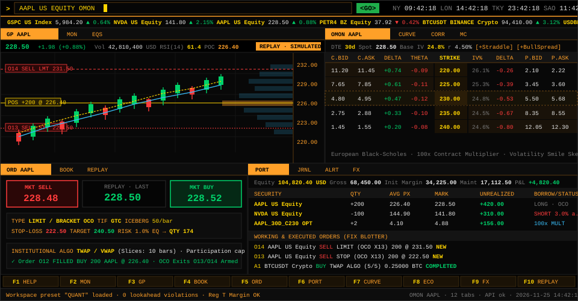

<p align="center">
  
</p>

<p align="center">
  
  
  
  
</p>

**Market Holder** is a deterministic multi-asset order matching engine, historical market replay clock, and keyboard-driven terminal workstation.

Unlike chart-only replay tools that fill orders optimistically at the bar close or rely on IEEE-754 floating-point math, Market Holder isolates a pure `Decimal` execution and margin core (`src/market_holder/engine/`) with strict anti-lookahead invariants, worst-case intrabar OCO resolution, Reg T maintenance margin liquidation, and synthetic European option chains.

<p align="center">
  
</p>

---

## Engineering Guarantees & Execution Invariants

1. **Zero-Lookahead Clock (`ReplayClock` & `LiveClock`):**
   - An order submitted at timestamp $t_{\text{order}}$ is eligible only for bars/ticks where $t_{\text{event}} \ge t_{\text{order}}$. Submitting an order while viewing a closed candle at $t_0$ can only match starting at $t_1$.
   - Macro panels (`CURVE`, `ECO`, `FX`) and quantitative scanners (`EQS`, `CORR`) truncate all upstream series at `session.clock.now`. Future bars are held inside `ReplayClock` and are never exposed by `GET /api/session/bars`.
2. **Intrabar Matching & Worst-Case OCO Priority (`engine/execution.py`):**
   - **Gap Openings:** A `LIMIT` order that gaps past its limit price fills at the bar's `open` (price improvement). A `STOP` order that gaps past its trigger fills at the `open` (adverse slippage). A `STOP_LIMIT` that gaps past its limit triggers but rests unfilled until price trades back within the limit on a subsequent bar.
   - **Pessimistic OCO Resolution:** When both the stop-loss and take-profit legs of an OCO/Bracket group fall within the `[low, high]` range of the same OHLC bar, the **stop-loss is evaluated and filled first** (`engine.py:139`).
   - **Volume Participation & Slippage:** Fills are clamped to `[bar.low, bar.high]`, quantized to `Instrument.tick_size` in the adverse direction, and capped per bar by `ExecutionModel.max_participation * bar.volume` and `Order.display_qty` (Iceberg).
3. **Multi-Currency Reg T Margin, Short Locate & Forced Liquidation (`engine/account.py`):**
   - Cash balances and realized P&L are tracked in each instrument's native currency and marked to the account's `base_currency` for portfolio equity and gross exposure.
   - Pre-trade checks enforce `lot_size`, `tick_size`, initial margin (`50%` gross exposure), and `locate_limit` on short sales. Orders that strictly reduce existing exposure bypass initial margin checks.
   - Daily stock borrow fees ($\text{Notional} \times r_{\text{borrow}} / 252$) are debited automatically on UTC session rollovers. When `equity < maintenance_required` (`25%` gross exposure) and `auto_liquidate=True`, the engine cancels working orders and liquidates open positions at market from largest to smallest exposure.

---

## System Architecture

The simulation engine has **zero imports** from the web framework or external data providers:

```
┌───────────────────────────────────────────────────────────────────────────┐
│ Providers (Binance, BCB SGS/PTAX, FRED, Tesouro Direto, Yahoo Finance)    │
│   └─► Gap-Aware SQLite BarCache (data/cache.sqlite)                       │
└───────────────────────────────┬───────────────────────────────────────────┘
                                │ Bar / Tick events
                                ▼
┌───────────────────────────────────────────────────────────────────────────┐
│ Clock Layer (ReplayClock: deterministic heap │ LiveClock: real-time push) │
└───────────────────────────────┬───────────────────────────────────────────┘
                                │ on_bar(Bar) / on_tick(Tick)
                                ▼
┌───────────────────────────────────────────────────────────────────────────┐
│ Isolated Simulation Core (src/market_holder/engine/)                      │
│   ├─► execution.py : OHLC/Tick matching, spread, impact, FeeSchedule      │
│   ├─► account.py   : Multi-ccy cash, Reg T margin, borrow fee, splits     │
│   ├─► engine.py    : FIX OrdStatus lifecycle, OCO, Iceberg, liquidation   │
│   ├─► options.py   : Black-Scholes pricing, Greeks, IV smile & inversion  │
│   ├─► quant.py     : Wilder RSI, RVOL, Pearson correlation, Monte Carlo   │
│   └─► bots.py      : Strategy bots, Sharpe/Sortino tear sheet, scenarios  │
└───────────────────────────────┬───────────────────────────────────────────┘
                                │ Snapshot & Event Stream
                                ▼
┌───────────────────────────────────────────────────────────────────────────┐
│ FastAPI Server (/api/* REST + /ws WebSocket) ◄──► React 19 Terminal (web) │
└───────────────────────────────────────────────────────────────────────────┘
```

---

## Workstation Functions & Command Line

Press `/` or `` ` `` anywhere to focus the command bar. The parser accepts full terminal syntax (`<TICKER> <EXCH> <SECTOR> <FUNCTION>`), dot notation (`PETR4.B3 GP`), internal IDs (`CRYPTO:BINANCE:BTCUSDT BOOK`), or standalone function codes:

| Code | Key | Function | Scope | Description |
|:---|:---:|:---|:---:|:---|
| **`GP`** | `F3` | Price Chart & Technicals | Security | Candlesticks, `SMA20`, `EMA9`, `VWAP`, `BB(20,2)`, `RSI(14)`, Volume Profile (`VPVR` + `POC`), persistent `S/R` & `Fib` drawings, click-to-move orders |
| **`BOOK`** | `F4` | Order Book & Time/Sales | Security | Live Binance L2 depth (`/depth`) & aggressor tape; tick-derived ladder (flagged `SIMULATED`) in replay |
| **`ORD`** | `F5` | Execution Ticket | Optional | 1-click Bid/Ask `MKT`, `LIMIT`, `STOP`, `STOP_LIMIT`, `Iceberg`, `TWAP`/`VWAP` slicing, `Bracket OCO`, and **Size by Risk %** calculator |
| **`OMON`** | — | Option Chain & Greeks | Optional | European Black-Scholes Call/Put chain, $\Delta, \Gamma, \Theta, \mathcal{V}$, volatility skew, and 1-click `Straddle` / `Bull Spread` / `Strangle` execution |
| **`PORT`** | `F6` | Portfolio & FIX Blotter | Global | Multi-currency cash, open positions, margin telemetry, working/filled orders, algo progress, and Corporate Actions (`SPLIT` / `DIVIDEND`) |
| **`MON`** | `F2` | Multi-Asset Watchlist | Global | Live & replay quotes across all session instruments with upstream provider name and declared latency |
| **`EQS`** | — | Equity Screener | Global | Scans session universe by `%Chg`, 20-bar Relative Volume (`RVOL`), `RSI(14)`, annualized realized vol, and 20-bar High/Low breakouts |
| **`CORR`** | — | Correlation & Beta | Global | Cross-asset return Pearson correlation heatmap and benchmark Beta ($\beta$) |
| **`MC`** | — | Monte Carlo Simulator | Global | Bootstraps closed blotter trades across $N$ paths to project 5th/50th/95th percentile terminal equity, max drawdown, and probability of ruin |
| **`BOT`** | — | Automated Strategy Console | Global | Deploy systematic trading bots (`SMA_CROSS`, `RSI_REV`, `TURTLE_20`, `VWAP_TREND`) against the replay or live stream (`ALGO` alias) |
| **`STATS`** | — | Performance Tear Sheet | Global | Portfolio Sharpe, Sortino, Calmar, Max Drawdown %, Win Rate, Alpha, and Base-100 Equity Curve vs. Buy & Hold (`PERF` alias) |
| **`CURVE`** | `F7` | Sovereign Yield Curve | Global | US Treasury term structure (`1M`..`30Y` via FRED) synced to replay date with `2s10s`, `3m10s`, and `5s30s` spreads in bps |
| **`ECO`** | `F8` | Macro Release Calendar | Global | BCB (`SELIC`, `IPCA`, `PTAX`) and FRED (`FEDFUNDS`, `CPI`, `UNRATE`) historical releases with Prior, 3M Consensus, Actual, and Surprise |
| **`FX`** | `F9` | FX Cross Matrix | Global | 5x5 spot cross-rate matrix (`USD`, `EUR`, `GBP`, `JPY`, `BRL`) and daily variations |
| **`JRNL`** | — | Trade Journal | Global | Log trade thesis, setup, confidence, and `#tags` with win-rate and net P&L attribution per tag |
| **`ALRT`** | — | Price Alerts | Global | Arm `ABOVE` / `BELOW` price triggers with Web Audio synthesizer tones and terminal toast notifications |
| **`REPLAY`**| `F10`| Session & Clock Control | Global | 146-security preset universe, global ticker search, `1x..1000x` playback, **10,000x Headless Fast-Forward**, and **Blind Replay Mode** |
| **`HP` / `DES`**| — | History / Description | Security | Tabular OHLCV history (`HP`) and contract specifications (`tick_size`, `lot_size`, `multiplier`, feed delay) (`DES`) |

### Workspace & Layout Commands
- `WS SCALP` · `WS MACRO` · `WS QUANT` · `WS OPTIONS` — Load pre-configured multi-panel desk layouts.
- `SAVE <name>` · `LOAD <name>` · `LAYOUTS` · `RESET` · `CLOSE` — Manage custom `flexlayout` grids persisted in `localStorage`.
- `Alt+1..9` / `Alt+←/→` / `Alt+W` — Focus tab by index, cycle tabs, or close the active tab via keyboard.

---

## Installation & Local Setup

Requires **Python 3.12+** and **Node.js 20+**.

```bash
# 1. Install Python package and start FastAPI backend on :8000
python -m venv .venv
.venv/Scripts/python -m pip install -e ".[api,dev]"      # Linux/macOS: .venv/bin/python
.venv/Scripts/python -m uvicorn market_holder.api.app:create_app --factory --port 8000

# 2. Install frontend dependencies and start Vite dev server (:5173 -> proxies /api & /ws to :8000)
npm --prefix web install
npm --prefix web run dev
```

---

## Verification & Test Suite

Every execution rule, margin threshold, OCO tie-breaker, and Black-Scholes identity is covered by hand-calculated unit tests:

```bash
# Backend unit & engine tests (164 tests) + Ruff linter
.venv/Scripts/python -m pytest -q
.venv/Scripts/python -m ruff check .

# Optional live provider validation against official endpoints (Binance, BCB, FRED, Tesouro, Yahoo)
.venv/Scripts/python -m pytest --live tests/test_live.py

# Frontend unit tests (Vitest, 36 tests) + TypeScript strict typecheck + production bundle
npm --prefix web test
npm --prefix web run typecheck
npm --prefix web run build
```

---

## Upstream Data Providers & Known Limits

| Provider | Coverage | Official | Latency / Notes |
|:---|:---|:---:|:---|
| **Binance** | Spot Crypto (`BTCUSDT`, `ETHUSDT`, …) | Yes | Real-time `bookTicker` WebSocket stream (~150ms fill latency), REST `/depth` L2 book, and historical klines |
| **BCB (SGS / Olinda)** | Brazil Macro & FX (`SELIC`, `IPCA`, `USDBRL` PTAX) | Yes | Official Central Bank of Brazil open data series |
| **FRED** | US Treasury Curve (`DGS1MO`..`DGS30`) & US Macro | Yes | Federal Reserve Bank of St. Louis daily/monthly series |
| **Tesouro Direto** | Brazilian Sovereign Bonds (`Tesouro Selic`, `IPCA+`) | Yes | Tesouro Transparente official historical PU & yield CSV |
| **Yahoo Finance** | Global Equities (40 exchanges), Indices, ETFs, Futures, FX | **No** | Undocumented public endpoint used as global fallback; subject to upstream rate limits (throttled to 2 req/s) |

> **Disclaimer:** Independent open-source simulation software for educational and quantitative research purposes. No real orders are routed and no financial advice is provided. Inspired by the keyboard ergonomics of professional trading terminals; not affiliated with, endorsed by, or derived from Bloomberg L.P. or any other vendor.
