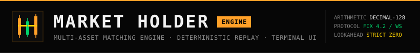

<p align="center"></p>

<p align="center">
  
  
  
  
</p>

**Market Holder** is a self-hosted, multi-asset trading workstation and market replay engine. It pairs an isolated `Decimal` matching and margin engine in Python with a keyboard-driven, command-line financial terminal interface in React.

It is built for practicing discretionary and systematic execution across equities, sovereign yield curves, FX, commodities, crypto, and European options—either replaying historical regimes at up to 10,000x speed or paper-trading live feeds—under strict anti-lookahead rules.

> **Simulation only.** No real brokerage connection, no real capital at risk. Every quote on screen carries its upstream provider and declared latency, and synthetic data (replay depth, Black-Scholes option chains) is explicitly flagged as simulated.

---

## Core Capabilities

### 1. Multi-Asset Markets & Macro Functions
- **Market Hours (`REPLAY` panel):** Every quote carries an OPEN/CLOSED flag and the next open or close, computed per exchange in local time with daylight saving (`domain/hours.py`, 40 exchanges, crypto 24/7, FX Sun-Fri, CME futures with the daily break). Replay uses the simulated clock; live uses the real clock and warns when every market in the session is closed. Regular sessions only: holidays, half days, auctions and pre/post-market are not modelled.
- **146 Ready-Made Global Securities (`MON`) + Global Search:** US, Brazil (B3), Europe (LSE, XETRA, Euronext, SIX), and Asia-Pacific (TSE, HKEX, KRX, NSE, ASX, TWSE) equities, major indices, ETFs, CME futures, FX crosses, and Binance spot crypto.
- **Sovereign Yield Curve (`CURVE` / F7):** US Treasury constant-maturity term structure (`1M` through `30Y` via FRED) synchronized to the replay timestamp, with live `2s10s`, `3m10s`, and `5s30s` inversion spreads in basis points.
- **Macro Release Calendar (`ECO` / F8) & FX Cross Matrix (`FX` / F9):** Central bank policy rates and inflation series (BCB Selic, IPCA, PTAX; FRED Fed Funds, CPI, Unemployment) with Actual vs. Prior and 3-period Consensus surprise, plus a 5x5 G10/EM currency cross-rate matrix.
- **Black-Scholes Option Chain (`OMON`):** Full Call/Put strike ladder synchronized with the underlying's session spot and realized volatility, computing $\Delta$, $\Gamma$, $\Theta$/day, $\mathcal{V}$, implied volatility smile skew, and 1-click multi-leg strategies (Straddle, Bull Call Spread, Strangle) with 100x contract multipliers.
- **Dynamic Equity Screener (`EQS`):** Scans all session securities on processed bars for `%Chg`, 20-bar Relative Volume (`RVOL`), Wilder's `RSI(14)`, annualized realized volatility, and 20-bar High/Low breakouts.

### 2. Execution Microstructure & Risk Engine
- **Isolated `Decimal` Matching Engine:** Market, Limit, Stop, and Stop-Limit orders with FIX lifecycle states (`NEW`, `PARTIALLY_FILLED`, `FILLED`, `CANCELED`, `REJECTED`, `EXPIRED`) and `DAY`, `GTC`, `IOC`, and `FOK` time-in-force.
- **Strict Anti-Lookahead & Worst-Case Intrabar Rules:** Orders submitted at $t$ only match bars with timestamp $\ge t+1$. Gap openings give realistic price improvement on limits and adverse slippage on stops. When both legs of an OCO bracket fit inside the same candle, the stop-loss fills first.
- **Short Selling, Locate Caps, Borrow Fees & Auto-Liquidation:** Configurable short locate inventory caps, automatic daily stock borrow fee accrual (`rate / 252`) on session rollovers, Reg T initial (50%) and maintenance (25%) margin checks, and automatic forced market liquidation when equity breaches maintenance margin.
- **Institutional Execution Algos & Risk Sizing (`ORD` / F5):** Native `Iceberg` orders (`display_qty` max fill per bar), parent-child `TWAP` and volume-weighted `VWAP` slicing across bars, OCO Bracket attachments, and 1-click **Size by Risk %** ($\lfloor \text{Equity} \times \text{Risk\%} / |\text{Entry} - \text{Stop}| \rfloor$).
- **Corporate Actions (`PORT` / F6):** Apply stock splits, reverse splits, and cash dividends per share directly to open positions during a session.

### 3. Quantitative Analytics & Charting (`GP`, `CORR`, `MC`)
- **Technical Charting & Volume Profile (`GP` / F3):** Candlesticks with forming live ticks, `SMA(20)`, `EMA(9)`, session `VWAP`, `Bollinger Bands(20, 2)`, live `RSI(14)` readout, horizontal **Volume Profile Visible Range (`VPVR`)** with Point of Control (`POC`), persistent S/R and auto-Fibonacci drawings, and click-to-move working orders on the chart.
- **Cross-Asset Correlation & Beta (`CORR`):** Rolling return Pearson correlation heatmap and benchmark Beta ($\beta$) across all session instruments.
- **Monte Carlo Risk & Ruin Simulator (`MC`):** Bootstraps closed round-trip trades from the blotter across hundreds of randomized paths to estimate 5th/50th/95th percentile terminal equity, maximum drawdown distribution, and probability of ruin.
- **Headless 10,000x Fast-Forward (`REPLAY` / F10):** Advance thousands of bars instantly without intermediate UI rendering bottlenecks.

### 4. Terminal Workflow, Workspaces & Blind Training
- **Command Line & Keyboard First:** Focus the command bar with `/` or `` ` ``. Enter security + function in professional syntax (`PETR4 BZ Equity GP`, `AAPL US Equity OMON`, `BTCUSDT Crypto BOOK`) or switch tabs with `Alt+1..9` and `Alt+←/→`.
- **Workspace Presets (`WS`):** Switch layouts with a single command: `WS SCALP`, `WS MACRO`, `WS QUANT`, `WS OPTIONS`, or save custom grids with `SAVE <name>` and `LOAD <name>`.
- **Blind Replay Mode (`REPLAY`):** Randomize security and historical window while masking ticker names (`BLIND-A MYST Asset`) and dates (`DAY-001`) to train pure price-action reading without hindsight bias.
- **Trade Journal (`JRNL`) & Audio/Visual Alerts (`ALRT`):** Tag trades (`#breakout`, `#vwap`, `#fomo`), track win rate and expectancy per tag, and arm price-crossing alerts with Web Audio synthesizer cues.

---

## Quick Start

Requirements: **Python 3.12+** and **Node.js 20+**.

```bash
# 1. Backend API (port 8000)
python -m venv .venv
.venv/Scripts/python -m pip install -e ".[api,dev]"      # Linux/macOS: .venv/bin/python
.venv/Scripts/python -m uvicorn market_holder.api.app:create_app --factory --port 8000

# 2. Frontend Terminal (port 5173, proxies /api and /ws to :8000)
npm --prefix web install
npm --prefix web run dev
```

Open the local URL printed by Vite, press **F10** (`REPLAY`), pick a basket or click **Start Random Blind Replay**, and press **Create session**.

---

## Terminal Command Reference

| Mnemonic | Function | Requires Security | Example Command |
|---|---|:---:|---|
| `GP` (F3) | Price Chart, Indicators, VPVR & Drawings | Yes | `AAPL US Equity GP` |
| `BOOK` (F4) | Order Book Ladder & Time and Sales | Yes | `BTCUSDT Crypto BOOK` |
| `HP` | Historical OHLCV Bars Table | Yes | `PETR4 BZ Equity HP` |
| `DES` | Security Contract Specifications & Feed | Yes | `VOD LN Equity DES` |
| `OMON` | Black-Scholes Option Chain & Greeks | Optional | `AAPL OMON` |
| `ORD` (F5) | Order Ticket, Risk Sizing, Bracket & Algos | Optional | `NVDA ORD` |
| `MON` (F2) | Multi-Asset Watchlist & Feed Latency | No | `MON` |
| `EQS` | Equity Screener (RVOL, RSI14, Breakouts) | No | `EQS` |
| `PORT` (F6) | Portfolio, Margin, Blotter & Corp Actions | No | `PORT` |
| `CORR` | Cross-Asset Correlation Matrix & Beta | No | `CORR` |
| `MC` | Monte Carlo Drawdown & Ruin Simulator | No | `MC` |
| `JRNL` | Trade Journal & Tag Attribution | No | `JRNL` |
| `ALRT` | Price Crossing Audio/Toast Alerts | No | `ALRT` |
| `CURVE` (F7) | Sovereign Yield Curve & Inversion Spreads | No | `CURVE` |
| `ECO` (F8) | Macro Series & Release Calendar | No | `ECO` |
| `FX` (F9) | FX Spot & 5x5 Cross-Rate Matrix | No | `FX` |
| `REPLAY` (F10) | Session Setup, Clock, Headless & Blind Mode | No | `REPLAY` |
| `WS` / `LOAD` | Load Workspace Preset or Saved Layout | No | `WS QUANT` / `WS SCALP` |

---

## Architecture & Verification

```
src/market_holder/
  domain/      Instrument, Bar, Tick, Order, Fill, Position, Portfolio, Symbol
  engine/      execution.py, account.py, engine.py, options.py, quant.py (zero web/provider imports)
  providers/   binance.py, bcb.py, fred.py, tesouro.py, yahoo.py + SQLite gap-aware cache
  clock/       ReplayClock (deterministic) and LiveClock (push)
  api/         FastAPI REST + WebSocket (/ws)
web/src/
  commands/    Command-line parser and terminal mnemonics
  layout/      flexlayout-react model, localStorage persistence, and workspace presets
  panels/      GP, OMON, Quant (EQS/CORR/MC), Journal (JRNL/ALRT), Ord, Port, Book, Macro, Mon, Replay
tests/         Hand-calculated engine, margin, options, OCO, bracket, and provider tests
```

| Check | Command |
|---|---|
| Backend unit & hand-calculated engine tests | `.venv/Scripts/python -m pytest -q` |
| Python linter | `.venv/Scripts/python -m ruff check .` |
| Frontend unit tests (Vitest) | `npm --prefix web test` |
| Frontend TypeScript check & production build | `npm --prefix web run typecheck && npm --prefix web run build` |

---

## Data Sources

| Provider | Asset Classes | Official API | Notes |
|---|---|:---:|---|
| **Binance** | Spot Crypto (`BTCUSDT`, `ETHUSDT`, …) | Yes | Real-time `bookTicker` WebSocket stream, L2 depth (`/depth`), and historical klines |
| **BCB (SGS & Olinda)** | Brazil Macro & FX (`SELIC`, `IPCA`, `USDBRL` PTAX) | Yes | Central Bank of Brazil open data endpoints |
| **FRED** | US Treasury Curve (`DGS1MO`..`DGS30`) & US Macro | Yes | Federal Reserve Bank of St. Louis |
| **Tesouro Direto** | Brazilian Sovereign Bonds (`Tesouro Selic`, `IPCA+`) | Yes | Tesouro Transparente daily PU & rates CSV |
| **Yahoo Finance** | Global Equities, Indices, ETFs, Futures, FX | No | Undocumented public endpoint used as global fallback; subject to rate limits |

---

## Disclaimer

Independent open-source educational simulator. Inspired by the keyboard workflows of professional financial terminals; not affiliated with, endorsed by, or derived from Bloomberg L.P. or any other vendor. No proprietary brand, logo, font, or code is used.
